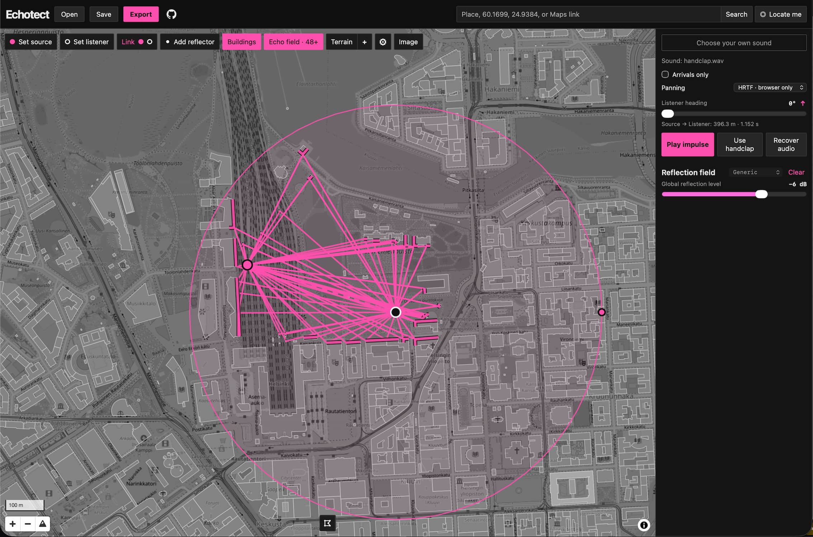

# Echotect: Turn your hood into a delay

Echotect turns real-world map geometry into musical delay structures. Place a
Source and Listener, then add Reflectors directly or derive them from nearby
surfaces with the Echo field. Audition the result in the browser, save it as an
editable project, or export it as audio and portable project data.

See it live: [**https://janne-s.github.io/Echotect/**](https://janne-s.github.io/Echotect/)

## How it works

All Reflectors participate in the same path model, including reflections between
surfaces. Longer paths arrive later and lose more level and high-frequency
energy; materials shape their absorption, and the spatial mode controls how the
result is heard. Audio can be exported as impulse responses, a wet render, or
aligned stems.

Map, Image, and Terrain are independent layers, and only the active one is
heard. Map and Image share the Source, Listener, reflectors, and structures;
Terrain has its own Source and Listener.

Use **Save** and **Open** for editable project files. Use **Export** for audio
and project manifests.

Structures are editable polygons in Map and Image modes. Their edges provide
reflective surfaces to the Echo field.

## Boomtect

A sound from [Boomtect](https://github.com/janne-s/Boomtect) arrives with its
place: **Send to Echotect** in Boomtect's export opens Echotect with it, or
choose Boomtect's Echotect package (ZIP) as your own sound. As Boomtect's
**Echotect with** chooses: with **Place**, the Listener goes
where the microphone was and the Source the way the sound came from, at its
distance and height; with **Direction**, only the Source moves; with **Sound
only**, nothing does, and the sound simply replaces the current one.
The sound already holds the air along that distance, so only the rest of each
path is absorbed. Reflectors stay where they are. A sound longer than two
seconds plays Rendered, since Live cannot start that many long voices in time.

## Heights

In Map and Image, **Source height** and **Listener height** set how high each
stands above the ground. Every reflector is a vertical wall, so a path from a
high Source reaches the Listener at an angle, and it passes over a wall where
it meets the wall above the building's height. Building heights come from the
map data when it has them; a wall of unknown height is never passed over. The
late field stays level.

## Buildings

- **Buildings** — Shows building footprints on the map.

## Image

- **Image** — Places a PNG, JPEG, or WebP image over the map. The image is saved
  in the project.
- **Scale** — Sets the image scale from a known distance between two points.
- **Rotation** — Rotates the image.
- **Opacity** — Sets how much of the map shows through the image.

## Terrain

- **Terrain** — Uses the elevation data inside a drawn rectangle as the echo
  field, or switches between the map and the saved terrain. The rectangle can
  be moved and reshaped.
- **+** — Draws a new terrain in place of the saved one.
- **Relief** — The mountain button beside the zoom controls switches the map to
  shaded relief.
- **Space panel** — Shows the terrain in 3D or as a section through the Source
  and Listener, in the side panel or its own window.
- **Canyon / Chamber** — Canyon reflects from the terrain surface. Chamber uses
  the terrain as a hollow above a flat floor. Each keeps its own Source and
  Listener placement.
- **Floor** — Sets the Chamber floor height.
- **Scale** — Scales the acoustic space from 1:100 to 10:1. The map does not
  change.
- **Listener height** / **Source height** — Sets the height above the ground,
  or above the Chamber floor.
- **Material** — Sets the absorption of the terrain surface.
- **Scattering** — Balances discrete echoes and diffuse scattering.
- **Ground reflection** — Sets the level of the reflection from the ground under
  the Source and Listener.
- **Delete terrain** — Removes the saved terrain.

## Echo field settings

- **Playback mode** — Plays directly in Live mode or prepares a reusable browser
  render when Rendered is selected.
- **Block reflections through buildings** — Prevents Echo field surfaces from
  reflecting sound to each other through intervening buildings.
- **Point reflections** — Chooses between a longer, more diffuse point-reflection
  response and stricter geometric decay.
- **Point persistence** — Sets how strongly sound continues between Point
  Reflectors in Persistent mode.
- **Point bounces** — Limits how many times a point-reflection path can bounce.
- **Point path limit** — Limits the number of point-reflection paths used.
- **Atmosphere** — Uses standard air conditions, custom conditions, or disables
  atmospheric timing and absorption adjustments.
- **Temperature** — Sets the air temperature for Custom atmosphere mode and
  changes the speed of sound used for every propagation time.
- **Relative humidity** — Sets the humidity for Custom atmosphere mode, including
  its smaller contribution to the speed of sound.
- **Air pressure** — Sets the air pressure for Custom atmosphere mode.
- **Air attenuation scale** — Adjusts the strength of air absorption; `1.00× ISO`
  is the normal model and `0.00×` disables its effect.
- **Geometric spreading** — Controls level loss over distance; `1/r` is the
  natural setting and Off removes this loss.
- **Material absorption scale** — Adjusts how strongly reflector materials color
  and absorb the sound; `1.00×` uses the normal material presets.
- **Late field** — Selects the Sampled paths response or the Feedback network.
- **Late field level** — Adjusts the level of the late response in decibels.
- **Response duration** — Sets the maximum Sampled paths response length.
- **Echo field surfaces** — Limits how many nearby building or terrain surfaces
  are used.
- **Late path samples** — Sets how many sampled paths form the late response.
- **Late field bounces** — Limits the number of surface bounces in the late
  field.
- **Cutoff level** — Stops paths after they have become quieter than this level.
- **Tail persistence** — Controls how readily sampled paths continue after
  each bounce.
- **Tail length** — Sets the Feedback network reverb time.
- **Density** — Controls how closely packed the Feedback network echoes are.
- **Damping** — Controls how quickly high frequencies fade from the Feedback
  network tail.
- **Geometry influence** — Controls how strongly the map geometry shapes the
  Feedback network.

## Max for Live

[Echotect Field](max-for-live/README.md) is one consumer of Echotect's JSON
project manifest. It brings the geometry into Ableton Live to recreate its
direct sound and reflection delays, with real-time controls for timing,
direction, width, path count, and the balance between the input and reflected
sound.

The Max for Live device is functional, but still rudimentary and under
development.

## Data attribution

Map and building layers retain their required attribution in the application.
OpenStreetMap data is © OpenStreetMap contributors. Overture Maps building data
is licensed under ODbL. The optional relief map uses OpenStreetMap data and
SRTM/Sonny elevation with the OpenTopoMap style under CC BY-SA. Terrain capture
elevation comes from
[Terrain Tiles](https://registry.opendata.aws/terrain-tiles/) on AWS Open Data,
compiled by Mapzen from SRTM, GMTED2010, NED, ETOPO1, and national datasets; see
their [attribution list](https://github.com/tilezen/joerd/blob/master/docs/attribution.md).

## Support Echotect

Support development through [GitHub Sponsors](https://github.com/sponsors/janne-s)
or [Ko-fi](https://ko-fi.com/jannesarkela). See
[Sanara Creations](https://www.sanaracreations.fi/) for related work.
